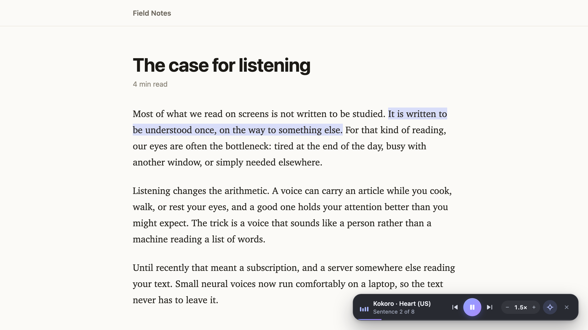

# Local TTS for your browser

Highlight text on any page, press play, and hear it read aloud by natural
neural voices that run entirely on your own computer.



Works in **Firefox**, **Chrome** and **Brave**. The voices come from
[local-tts](https://github.com/0xkato/local-tts), which also has a desktop app.

## Features

- **Read any selection.** A play button appears next to text you highlight.
  Right-click → *Read aloud* and <kbd>⌥ Option</kbd> <kbd>⇧ Shift</kbd> <kbd>R</kbd> work too, so
  the button can be switched off when it gets in the way.
- **Follow along.** The sentence being read is highlighted on the page, and the
  page scrolls with it. Switch that off to look around while it reads.
- **A small control bar.** Pause, previous and next sentence, speed from 0.5×
  to 2×, and a level meter that moves with the voice.
- **Voices you can choose.** Kokoro (Heart by default), Phonon and Ming, with
  several voices each, American and British.
- **Private.** The text never leaves your computer: no account, no cloud, no
  tracking.
- **Light.** The voice model loads when you press play and is unloaded after
  five minutes of quiet.

## Requirements

- A Mac. Kokoro and Ming need Apple Silicon; Phonon also runs on Intel Macs.
  Linux may work with Phonon but is untested.
- Firefox 140 or newer, Chrome, or Brave.
- [Homebrew](https://brew.sh) for `espeak-ng` (Kokoro's pronunciation of
  unusual words) and `ffmpeg` (speed control for Phonon and Ming).
- [uv](https://docs.astral.sh/uv/getting-started/installation/) to install the
  Python parts.
- About 1.3 GB of disk for the voice software, plus 220 MB to 3 GB per voice,
  downloaded the first time that voice reads.

## Install

**1. The tools**

```bash
brew install espeak-ng ffmpeg
```

**2. The voices and the helper**

```bash
git clone https://github.com/0xkato/local-tts-plugin.git
cd local-tts-plugin
./install.sh
```

This sets up the voices (shared with the local-tts desktop app, if you use
it) and the small helper program the extension talks to, and registers the
helper with whichever of Firefox, Chrome and Brave you have (run it again if
you add one later). Everything goes in `~/.local/share/local-tts-plugin`; the
cloned folder is not needed afterwards.

**3. The extension**

- **Firefox:** download `local-tts.xpi` from
  [Releases](https://github.com/0xkato/local-tts-plugin/releases) and open it in
  Firefox, then click **Add**.
- **Chrome or Brave:** open `chrome://extensions` (or `brave://extensions`),
  turn on **Developer mode**, click **Load unpacked** and pick
  `~/.local/share/local-tts-plugin/extension`.

## Using it

| | |
|---|---|
| Start reading | Highlight text, then press the ▶ button beside it — or right-click → *Read aloud*, or <kbd>⌥</kbd><kbd>⇧</kbd><kbd>R</kbd> |
| Pause / resume | The bar's middle button, or <kbd>⌥</kbd><kbd>⇧</kbd><kbd>P</kbd> from anywhere |
| Skip a sentence | ⏮ ⏭ on the bar |
| Speed | − / + on the bar, or the slider in the toolbar panel |
| Follow along | The target button on the bar, or the switch in the toolbar panel |
| Find your place | Click the bar's title to jump to the sentence being read |
| Hide the play button | The *Play button* switch in the toolbar panel; right-click → *Read aloud* and <kbd>⌥</kbd><kbd>⇧</kbd><kbd>R</kbd> still work |
| Voice | The toolbar button: pick an engine and a voice |

Reading carries on when you switch tabs, and stops when you close the page.
The first play takes a few seconds while the voice loads. Shortcuts can be
changed in your browser's settings for extension shortcuts.

## How it works

```
browser extension ──native messaging──▶ helper program ──▶ voice worker
  play button, control bar,              sentences, playback   Kokoro / Phonon / Ming
  sentence highlighting                  (local-tts engine)
```

A browser extension cannot run a voice model, so the extension hands the text
to a small helper program on your computer, over the browser's *native
messaging* channel, which only this extension can reach. The helper splits
the text into sentences, has the voice prepare the next few while one plays,
and plays the audio; the page shows which sentence is being read. When
nothing has played for five minutes the helper quits, freeing the model's
memory, and the next play starts it again.

## Privacy

The extension asks to "access your data for all websites" so that the play
button can appear wherever you select text. It reads a page only when you
press play, and then only the text you selected, which goes to the helper on
your computer and nowhere else. Nothing is sent over the network, and nothing
is collected. Your voice and speed choices are kept in the browser's storage
for the extension.

## Troubleshooting

- **"The Local TTS helper isn't installed"**: run `./install.sh`.
- **No play button on a page**: extensions can't run on the browser's own pages
  (`about:`, `chrome://`), the add-on stores or the built-in PDF viewer, and
  Google Docs draws its text in a way the extension can't select.
- **Check what is missing**:
  ```bash
  ~/.local/share/local-tts-plugin/env/bin/python -m local_tts_plugin.register status
  ```
- **Logs**: `~/.local/share/local-tts-plugin/host.log`, and `voices-worker.log`
  next to it.

## Uninstall

Remove the extension from your browser, then:

```bash
~/.local/share/local-tts-plugin/env/bin/python -m local_tts_plugin.register uninstall
rm -rf ~/.local/share/local-tts-plugin
```

The voices stay in `~/.local/share/local-tts/voices-env`, and their models in
`~/.cache/huggingface`, in case the local-tts desktop app uses them; delete
those too if it doesn't.

## Development

```bash
./install.sh --dev        # the helper runs from this folder: edits apply at once
uv venv -p 3.11 .venv && VIRTUAL_ENV=.venv uv pip install -e ".[dev]"
.venv/bin/python -m pytest tests/
```

The helper is tested the way a browser runs it, on a silent test voice.
`tests/test_browsers.py` drives headless Firefox and Chrome that Selenium
downloads into `~/.cache/selenium`, never your installed browsers. To try
extension changes in Firefox without signing, load `extension/manifest.json`
from `about:debugging#/runtime/this-firefox` → **Load Temporary Add-on…**; for
Chrome and Brave, run `./install.sh` again and reload the extension.

To move to a newer local-tts, change the tag in `pyproject.toml` and run
`./install.sh` again.

### Releasing

Firefox installs only add-ons signed by Mozilla. `./sign.sh` signs the
extension as an *unlisted* add-on: not listed on addons.mozilla.org, but
installable from anywhere. It needs an API key from
[addons.mozilla.org](https://addons.mozilla.org/developers/addon/api/key/).

1. Raise `version` in `extension/manifest.json`; each signed version is final.
2. `WEB_EXT_API_KEY=user:… WEB_EXT_API_SECRET=… ./sign.sh`
3. Attach `~/.local/share/local-tts-plugin/local-tts.xpi` to a GitHub release as
   `local-tts.xpi`.

## License

[MIT](LICENSE)
